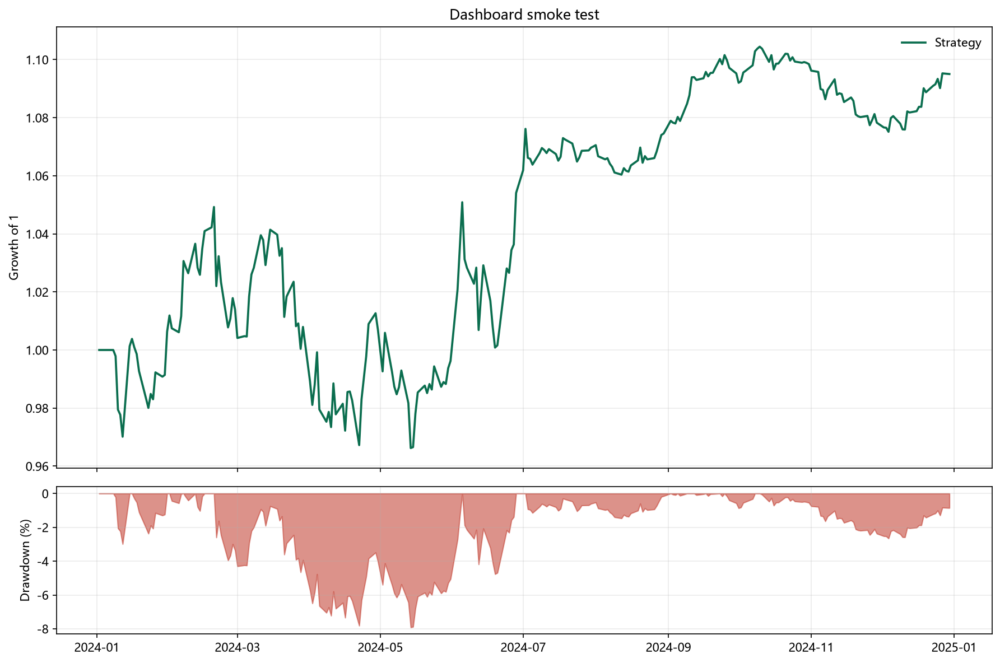
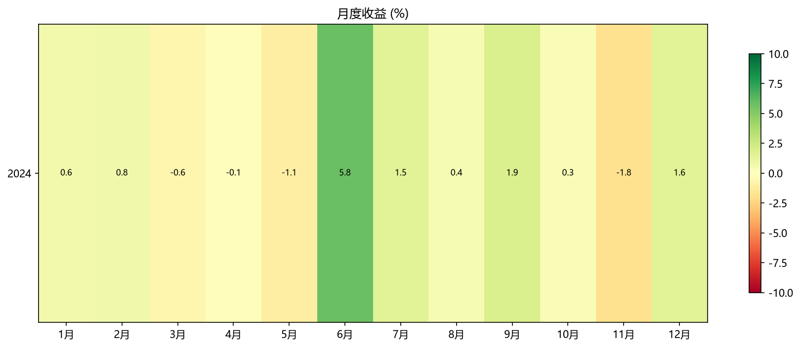

# Dashboard smoke test

生成时间：2026-11-08 06:35:20

## 核心指标

| 指标 | 数值 |
|---|---:|
| 累计收益 | 9.50% |
| 年化收益 | 9.20% |
| 年化波动 | 11.44% |
| 夏普比率 | 0.83 |
| 索提诺比率 | 0.84 |
| 最大回撤 | -7.91% |
| 卡玛比率 | 1.16 |
| 日胜率 | 50.38% |
| 盈亏比 | 1.17 |
| 区间单边换手 | 81.39% |
| 平均仓位 | 58.07% |
| 年化 Alpha | — |
| Beta | — |
| 信息比率 | — |
| 跟踪误差 | — |
| 年化单边换手 | 78.89% |

## 净值与回撤



## 月度收益



## 配置

```json
{
  "initial_cash": 500000,
  "execution_price": "next_open",
  "lot_size": 100,
  "max_position_weight": 0.25,
  "max_gross_exposure": 0.95,
  "max_adv_participation": 0.1,
  "adv_includes_today": false,
  "symbols_in_panel": 4,
  "symbols_ever_held": 4,
  "delisted_candidates": 0,
  "delisted_exits": 0,
  "trades": 8,
  "traded_notional": 849928.4572617582,
  "annual_turnover": 0.7888851551416811,
  "turnover_definition": "turnover = one-way traded notional / average equity over the full backtest; annual_turnover = turnover * 252 / trading days",
  "bars": 1040,
  "costs": {
    "commission_rate": 0.00025,
    "min_commission": 5.0,
    "stamp_duty_rate": 0.0005,
    "transfer_fee_rate": 1e-05,
    "slippage_bps": 5.0,
    "impact_coefficient_bps": 0.0
  }
}
```